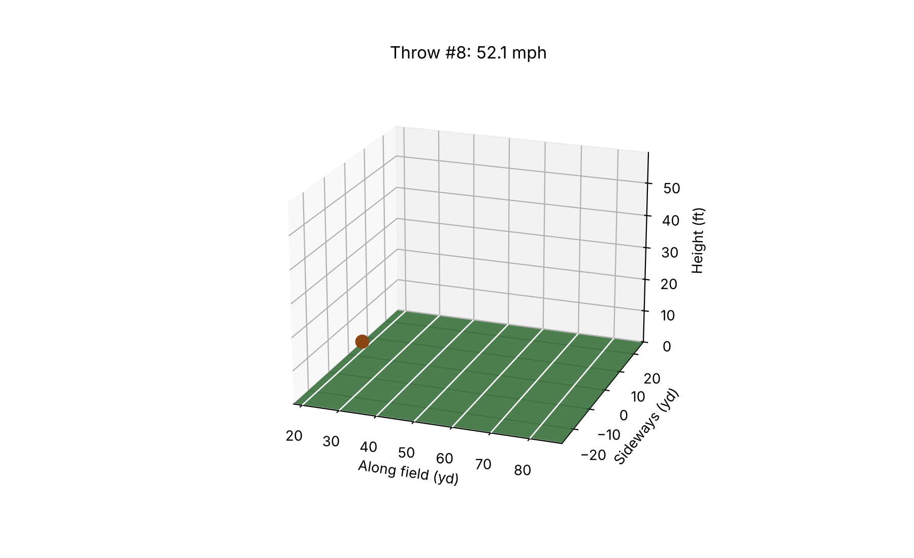
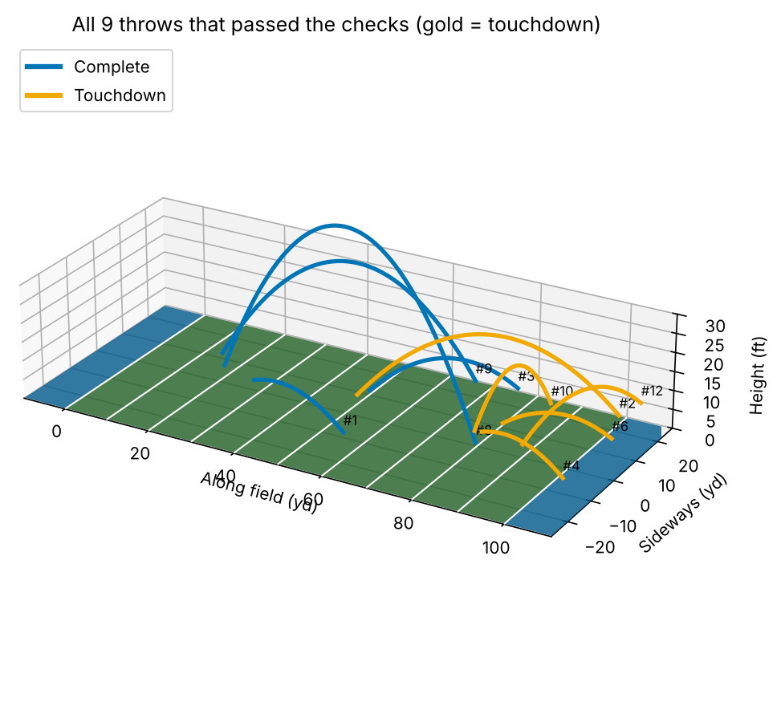
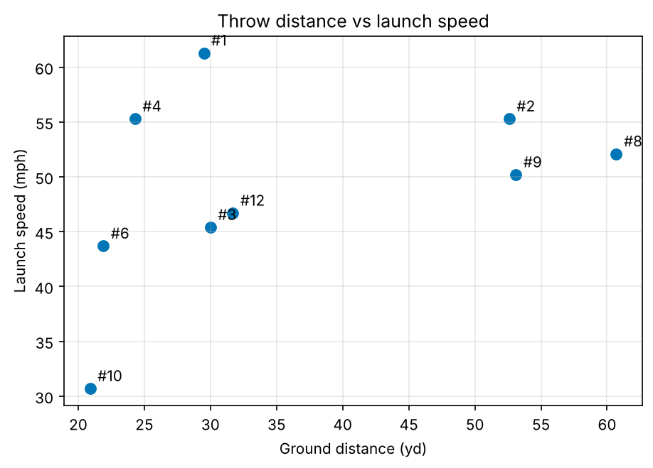
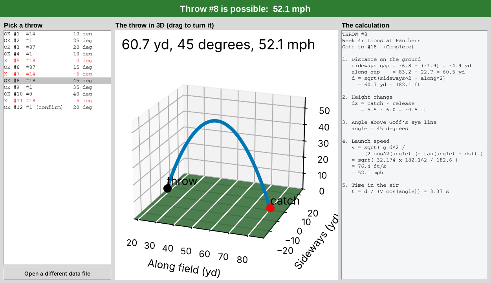
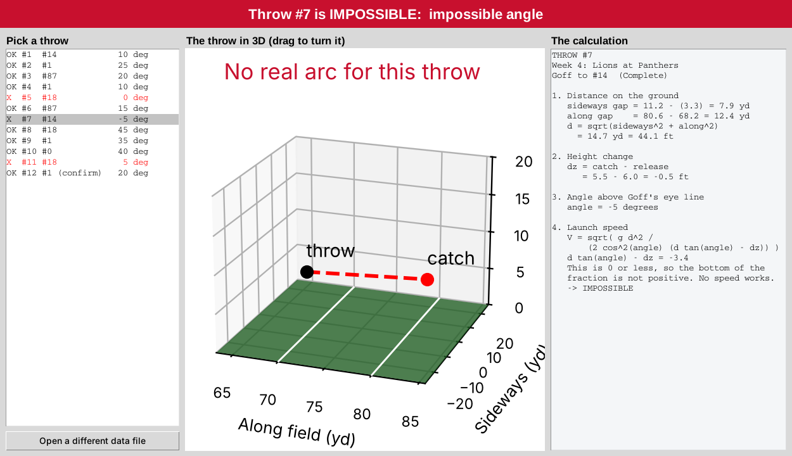

# How Fast Does He Really Throw?

My MYP Personal Project. I wanted to know how fast Jared Goff throws the football. NFL Next Gen Stats tracks where
the ball goes on the field, but it doesn't say how high the ball flies or how fast it leaves the quarterback's hand.
So I worked it out with projectile motion and Python.



## My data

I watched Lions games and logged 12 completed passes in `data/throws.xlsx` (Weeks 3 to 5 of 2026). For each pass I wrote down:

- **where Goff threw it from and where it was caught**, in yards, read off the Next Gen Stats field graphics. Sideways is yards from the middle of the field and along field is yards from the Lions' own goal line.
- **the angle**: how many degrees **above Goff's eye-level line** the ball started out (straight ahead, level with his eyes, is 0 degrees). I estimated this by eye while watching each play.

Because I measure the angle from his eye line, I say the ball starts at his eye height. Goff is 6'4", so that's about 6 ft.

## The math

1. **Distance on the ground (Pythagorean theorem):**
   `d = sqrt(sideways gap^2 + along-field gap^2)`, then multiply by 3 to get feet.
2. **Projectile motion.** If the ball leaves at speed V and angle theta:
   - sideways along the ground: `d = V cos(theta) t`
   - up and down: `dz = V sin(theta) t - 1/2 g t^2`, where dz = catch height - release height
3. **Get rid of t.** From the first equation `t = d / (V cos(theta))`. Put that into the second one:
   `dz = d tan(theta) - g d^2 / (2 V^2 cos^2(theta))`
4. **Solve for V:**

```
V = sqrt( g d^2 / ( 2 cos^2(theta) ( d tan(theta) - dz ) ) )
```

g = 32.174 ft/s^2. To change ft/s to mph, multiply by 3600 and divide by 5280.

**Checking the formula:** `check_formula.py` "throws" a ball at a speed I pick, works out where it lands, then puts
that distance back into my formula. It gives back the same speed every time (40, 50 and 60 mph).

## Checking for bad data

A throw gets flagged if:

- **impossible angle**: the ball would already be lower than the catch point before it got there, even without gravity, so no speed could make the throw. This happens with a negative angle (below eye level), like throw #7 at -5 degrees.
- **too fast to be real**: the speed comes out over 70 mph, which I picked as the limit for a realistic NFL throw. This happens when my angle is too flat: throw #5 at 0 degrees comes out at 131.8 mph and throw #11 at 5 degrees at 78.0 mph.

Flagged throws are left out of the graphs and the 3D pictures.

## Results

9 of my 12 throws passed the checks. Their average launch speed was **49.0 mph**, from 30.7 mph (a 21-yard
touchdown thrown high at 40 degrees) to 61.3 mph. The other 3 (#5, #7 and #11) had angles that were impossible or
too flat, so I need to rewatch those plays and measure the angles again.





## The demo app

`app.py` is a simple window for showing the project:

- **left:** pick a throw (the red ones failed the checks)
- **middle:** the throw drawn in 3D on the field (drag it with the mouse to turn it)
- **right:** the calculation, step by step
- **top bar:** green if the throw is possible, red if it is impossible





**Making the .exe (no Python needed to run it):**

- **On a Windows computer with Python:** double-click `build_exe.bat`. After 2 to 3 minutes the app is in the `dist` folder as `QB-Throw-Speed.exe`.
- **Without Python:** put this folder on GitHub, open the **Actions** tab, choose **Build Windows exe**, and click **Run workflow**. When it finishes, download the `.exe` from the bottom of the run page.
- **On a Mac:** run `bash build_exe_mac.sh`.

The app has my data built in. If a `data/throws.xlsx` file is in the same folder as the `.exe`, it uses that file
instead, so I can update my data without rebuilding. The **Open a different data file** button loads any Pass Log.
Windows may warn about an unknown app the first time; click **More info**, then **Run anyway**.

## How to run it

1. Install Python 3 from python.org (on Windows, tick "Add Python to PATH").
2. Open a terminal in this folder and install the libraries:
   ```
   pip install -r requirements.txt
   ```
3. Run the whole project:
   ```
   python main.py
   ```
   or open the demo app with `python app.py`.

It prints the table of speeds, saves everything in the `output` folder, and opens the 3D field so you can rotate it
with the mouse. On a Mac use `pip3` and `python3`.

## What `main.py` makes (in the output folder)

| File | What it is |
|---|---|
| `results.csv` | every throw with its distance, angle, speed, hang time and check |
| `graph_angle_histogram.png` | how my angles are spread out |
| `graph_speed_histogram.png` | how the speeds are spread out |
| `graph_distance_vs_angle.png` | distance vs angle |
| `graph_distance_vs_speed.png` | distance vs speed |
| `3d_all_throws.png` | every throw as an arc on the field (blue = complete, gold = touchdown) |
| `3d_all_throws_side_view.png` | the same throws seen from the sideline |
| `3d_throw_8.png` | a close-up of my longest throw |
| `animation_throw_8.gif` | the ball flying on that throw |

## Files

```
main.py            runs everything
app.py             the demo app (pick a throw, see it in 3D, see the calculation)
build_exe.bat      makes the Windows .exe
throw_speed.py     reading the data + the math
graphs.py          the 4 graphs
field3d.py         the 3D field, the arcs and the animation
check_formula.py   proves the speed formula works
data/throws.xlsx   my Pass Log
```

## Things I assumed

- No air resistance, so real speeds are probably a bit higher.
- The ball starts at Goff's eye height (6 ft) and is caught chest high (5.5 ft).
- My angles are estimates by eye, so every speed is an estimate too.
- My positions come from reading the Next Gen Stats graphics by hand and could be off by a yard or two.

## Credits

The idea of estimating the missing height came from the NFL3D project (dutta.github.io/nfl3d.html). Positions come
from NFL Next Gen Stats. I used an AI assistant (Claude) to help write and explain the code.
